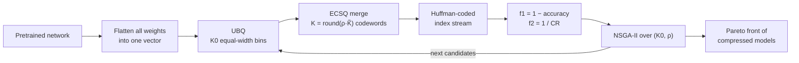

# EvoDeepQuantization

Official implementation of

> **A Structure-Agnostic Multi-Objective Evolutionary Weight-Sharing Compression Framework for Deep Neural Networks**
> *IEEE Transactions on Big Data* (accepted).

**UB-ECSQ-NSGA2** compresses a pretrained network by weight sharing. It needs no retraining and
no gradients, and it never looks at the architecture. All weights are flattened into one vector
that shares a single codebook:

1. **Uniform Binning Quantization (UBQ)**: the vector is cut into K0 equal-width bins, anchored
   at zero, in O(N) time. Each occupied bin is represented by the mean of its weights, and empty
   bins are dropped.
2. **Entropy-Constrained Scalar Quantization (ECSQ)**: neighboring bins are merged by an exact
   dynamic program that trades the added distortion against the entropy of bin occupancy. The
   merge uses only bin statistics, so it needs no forward pass.
3. **Huffman coding** of the index stream gives the stored size.
4. **NSGA-II** searches over just two variables, the bin count K0 and the merge ratio ρ, and
   returns a Pareto front of compressed models that trade calibration accuracy against
   compression ratio (CR).



## Results

The table shows the CR of UB-ECSQ-NSGA2 at a 1% drop in top-1 accuracy, and the hypervolume of
its final Pareto front (mean ± std over five search seeds; from Tables I–III and V of the paper).
Accuracy is measured on the calibration split.

| Dataset | Model | Uncompressed acc. (%) | CR at −1% acc. | Hypervolume |
|---|---|---|---|---|
| CIFAR-10 | ResNet-18 | 95.10 | 20.8 ± 0.3 | 0.9169 ± 0.0003 |
| CIFAR-100 | ResNet-18 | 76.66 | 12.9 ± 0.2 | 0.7358 ± 0.0004 |
| ImageNet-1K | ResNet-18 | 69.58 | 10.5 ± 0.1 | 0.6595 ± 0.0003 |
| ImageNet-1K | ResNet-34 | 73.46 | 10.9 ± 0.1 | 0.6992 ± 0.0003 |
| ImageNet-1K | ResNet-50 | 76.34 | 10.4 ± 0.1 | 0.7208 ± 0.0006 |
| ImageNet-1K | ResNet-101 | 77.12 | 12.3 ± 0.0 | 0.7331 ± 0.0006 |
| ImageNet-1K | VGG16-BN | 72.92 | 18.4 ± 0.1 | 0.7004 ± 0.0002 |
| ImageNet-1K | ViT-B/16 | 80.76 | 9.0 ± 0.0 | 0.7475 ± 0.0001 |

In every setting the front has the highest hypervolume of all compared methods: K-means (Deep
Compression), Hessian K-means, Uniform Quantization and Iterative ECSQ (Choi et al.), GPTQ, and
the layer-wise method of Dupuis et al.

## Installation

```bash
git clone https://github.com/rkhosrowshahi/EvoDeepQuantization.git
cd EvoDeepQuantization
pip install -r requirements.txt   # install PyTorch for your CUDA version first
```

Python 3.9 or later is required. Tested with Python 3.13, PyTorch 2.13, torchvision 0.28 and
pymoo 0.6.2.

## Data and pretrained models

* **CIFAR-10/100** is downloaded to `./data` on first use. The ResNet-18 checkpoints used in the
  paper are downloaded from the
  [Hugging Face Hub](https://huggingface.co/Raasa/moea-compression-checkpoints) to
  `./checkpoints` on first use. To train them yourself, see `train_cifar.py`.
* **ImageNet-1K**: only the validation set is used. Put `ILSVRC2012_img_val.tar` and
  `ILSVRC2012_devkit_t12.tar.gz` in `./data/imagenet`, and torchvision prepares them on first
  use. To use another location, pass `--data_dir`. The models are torchvision's
  `IMAGENET1K_V1` checkpoints.

Every candidate is scored on a **calibration split** that is disjoint from the test set:
* CIFAR: a class-balanced 10% of the training set (5,000 images), held out when the networks
  were trained.
* ImageNet: 5,000 of the 50,000 validation images, with a disjoint 40,000-image test split.

## Quick start

```bash
python main.py --config configs/cifar10/resnet18/seed1.yaml
```

This runs the bisection warm-up that sets the K0 range, then 10 NSGA-II generations of 100
candidates, and writes to `results/cifar10/resnet18/seed1/`:

| File | Content |
|---|---|
| `final_pareto_front.csv` | the final Pareto front, one compressed model per row |
| `hypervolume_history.csv` | hypervolume of the front after each generation |
| `steps/step_<g>_pareto_front.csv` | the front after generation g |
| `figures/` | Pareto front and hypervolume plots |
| `run.log` | the console output |

Columns of `final_pareto_front.csv`:

| Column | Meaning |
|---|---|
| `n_bins` | K0, the requested number of uniform bins |
| `rho` | ρ, the merge ratio |
| `n_bins_realized` | K̃, the number of non-empty bins |
| `n_parameter_sharing` | K, the number of shared values (codewords) after merging |
| `bpw` | log2 K, the cost of a fixed-width index |
| `val_eval_score` | top-1 accuracy on the calibration split |
| `test_eval_score` | top-1 accuracy on the test split (only with `--eval_test`) |
| `cr` | compression ratio with Huffman-coded indices (Eq. 2) |
| `compressed_size_bits/bytes/mb` | size of the compressed weights |

Any value in a config can be overridden on the command line, for example
`--gpu 1`, `--data_dir /datasets/imagenet` or `--eval_test`. Run `python main.py --help` for all
options. Pass `--wandb` to log to Weights & Biases.

## Reproducing the paper

### UB-ECSQ-NSGA2

There is one config per setting and search seed in `configs/<dataset>/<arch>/seed<1-5>.yaml`:

| Dataset | Architectures | Generations | Time per seed on one GPU |
|---|---|---|---|
| `cifar10`, `cifar100` | `resnet18` | 10 | about 30 min |
| `imagenet` | `resnet18`, `resnet34`, `resnet50`, `resnet101` | 15 | 40 min to 2 h |
| `imagenet` | `vgg16_bn`, `vit_b_16` | 15 | 5 to 7 h |

```bash
for seed in 1 2 3 4 5; do
    python main.py --config configs/imagenet/resnet50/seed${seed}.yaml
done
```

The settings follow Section IV-A of the paper: a population of 100, SBX crossover
(p = 0.9, η = 15), polynomial mutation (p = 0.9, η = 10), and K0 bounds from the bisection
warm-up with thresholds of 50% and 0.5% relative accuracy loss. The calibration batch size is
512 on CIFAR and 256 on ImageNet.

### Baselines

Every baseline uses the same checkpoint and calibration split as UB-ECSQ-NSGA2. The
codebook-based methods are sized with the same Huffman-coded accounting, and GPTQ with its own
fixed-width codes, as in the paper. Each run writes a CSV to `results/baselines/` with the
calibration accuracy and the CR of every evaluated point. Use `--arch` to pick the ImageNet
model, and `--eval_test` to also report test accuracy.

| Method | Command | Notes |
|---|---|---|
| K-means (Han et al.) | `python baselines/run_kmeans.py --dataset cifar10` | one global codebook, K = 4 … 1024 |
| Uniform Quantization (Choi et al.) | `python baselines/run_uniform.py --dataset cifar10` | UBQ alone, K0 = 2 … 2048 |
| Hessian K-means and Iterative ECSQ (Choi et al.) | `python baselines/run_choi2017.py --dataset cifar10` | empirical Fisher diagonal as the Hessian |
| GPTQ (Frantar et al.) | `python baselines/run_gptq.py --dataset cifar100` | 2, 3, 4, 6 and 8 bits; the paper ran CIFAR-10 at `--bits 4` only; CNNs only |
| Dupuis et al. | `python baselines/run_dupuis2022.py --dataset cifar10` | layer-wise; CNNs only; the slowest baseline |

For ImageNet, add `--dataset imagenet --arch <model>`, for example
`python baselines/run_kmeans.py --dataset imagenet --arch vgg16_bn`.

### Tables and hypervolume

The paper reports **calibration** accuracy. For each accuracy target, a table cell is the most
compressed evaluated point whose calibration accuracy meets the target. Table V is the
hypervolume of each front in the (1 − accuracy, 1/CR) plane, with reference point (1, 1):

```python
import pandas as pd
from ubecsq.objectives import hv_bounded

front = pd.read_csv("results/cifar10/resnet18/seed1/final_pareto_front.csv")
print(hv_bounded(list(zip(1 - front.val_eval_score, 1 / front.cr))))
# baselines: use the cr_huffman column (cr_raw for GPTQ)
```

Runs are deterministic for a given seed on a given hardware and software stack. Small
differences across GPUs and library versions are expected, which is why the paper reports
results over five search seeds. Hessian K-means and Iterative ECSQ weight their clustering by a
Fisher diagonal. It is computed with deterministic GPU kernels, so reruns match each other, but
points close to the accuracy cliff can differ from the published ones.

## Where things are

| Paper | Code |
|---|---|
| Flattening of all weights into one vector (Sec. III) | `utils/compression/quantization.py`: `get_model_params` |
| UBQ (Sec. III-A, Eqs. 3–6) | `utils/compression/quantization.py`: `uniform_bin_edges`, `uniform_binning` |
| Entropy-constrained merge (Alg. 2) | `utils/compression/ecsq.py`: `dp_merge` |
| Merge ladder and nearest rung (Alg. 3) | `utils/compression/ecsq.py`: `build_merge_ladder`, `nearest_rung` |
| Automatic K0 range (Alg. 4) | `ubecsq/warmup.py`: `find_k_bounds` |
| Candidate evaluation (Alg. 5) | `ubecsq/search.py`: inner loop of `run_ecsq` |
| NSGA-II search (Alg. 1) | `ubecsq/search.py`: `run_ecsq` |
| Huffman-coded compression ratio (Eq. 2) | `utils/compression/storage.py`: `size_of_model` |
| Hypervolume (Table V) | `ubecsq/objectives.py`: `hv_bounded` |

```
├── main.py                 # UB-ECSQ-NSGA2 on one (dataset, model, seed)
├── train_cifar.py          # trains the CIFAR ResNet-18 checkpoints (optional)
├── configs/                # one YAML per dataset / model / search seed
├── ubecsq/                 # the search: NSGA-II, warm-up, objectives, logging
├── utils/
│   ├── compression/        # UBQ, ECSQ merge, Huffman coding, storage accounting
│   ├── dataset.py          # CIFAR / ImageNet with the calibration and test splits
│   └── models.py           # pretrained models
└── baselines/              # K-means, Choi et al., GPTQ, Dupuis et al.
```

## Citation

```bibtex
@article{khosrowshahli2026evodeepquantization,
  title   = {A Structure-Agnostic Multi-Objective Evolutionary Weight-Sharing Compression Framework for Deep Neural Networks},
  author  = {Khosrowshahli, Rasa and Rahnamayan, Shahryar and Ombuki-Berman, Beatrice},
  journal = {IEEE Transactions on Big Data},
  year    = {2026},
  volume  = {TODO},
  pages   = {TODO},
  doi     = {TODO}
}
```

## License

[MIT](LICENSE)
